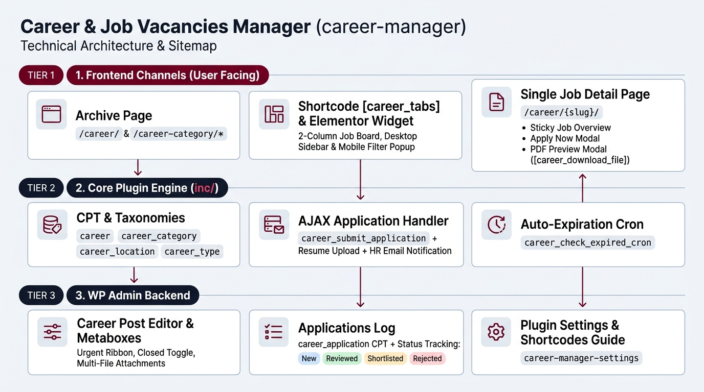

# Career & Job Vacancies Manager (`career-manager`)

ปลั๊กอินระบบ **ร่วมงานกับเรา / ประกาศรับสมัครงาน (Career & Job Opportunities)** แบบ **Standalone 100%** สร้างแยกเป็นปลั๊กอินอิสระเพื่อให้นำไปติดตั้งและใช้งานในทุกโปรเจกต์ WordPress ได้ทันทีโดยไม่พึ่งพาธีมเดิม


---

## ตัวอย่างการแสดงผล (UI Preview)

### 1. มุมมองหน้าจอคอมพิวเตอร์ (Desktop 2-Column Job Board)
<div align="center">
  
</div>

### 2. มุมมองหน้าจอมือถือและหน้าต่างตัวกรองอัจฉริยะ (Mobile Responsive & Filter Popup)
| รายการประกาศงานบนมือถือ (Mobile Job Cards) | หน้าต่างตัวกรองแบบ Popup (Click Filter Modal) |
| :---: | :---: |
|  |  |

---

## แผนผังสถาปัตยกรรมและโครงสร้างระบบ (Architecture & Sitemap)

<div align="center">
  
</div>

### โครงสร้างไฟล์ภายในปลั๊กอิน

```text
career-manager/
├── career-manager.php                     # ไฟล์หลักของปลั๊กอิน (Bootstrap, Asset Enqueue, Elementor Registration)
├── README.md                              # คู่มือการใช้งานและการนำไปติดตั้งในโปรเจกต์อื่น
├── inc/
│   ├── helpers.php                        # ฟังก์ชันช่วยเหลือ (วันที่ พ.ศ. ไทย, ไอคอน SVG, นับยอดเข้าชม, ดึงไฟล์ PDF, 2 ภาษา TH/EN)
│   ├── post-types.php                     # ลงทะเบียน CPT `career`, Taxonomies (`career_category`, `career_location`, `career_type`) และปุ่มสร้างข้อมูลตัวอย่าง
│   ├── metaboxes.php                      # กล่องตั้งค่าหลังบ้าน: ป้ายด่วน, แนบไฟล์หลายไฟล์ (*.pdf, *.zip, *.rar, *.docx), วันหมดอายุอัตโนมัติ, Live Preview
│   ├── admin-columns-filters.php          # คอลัมน์และตัวกรองค้นหาขั้นสูงในหลังบ้าน + หน้าตั้งค่าสี/ข้อความ (Settings & Shortcodes)
│   ├── applications.php                   # ระบบรับใบสมัครงาน AJAX, อัปโหลดเรซูเม่, ส่งอีเมลแจ้งเตือน HR และบันทึกประวัติใบสมัคร (`career_application`)
│   ├── shortcodes-modals.php              # Shortcodes `[career_tabs]`, `[career_download_file]`, Force Download และหน้าต่าง PDF Preview Modal
│   └── template-loader.php                # โหลดเทมเพลต `archive-career.php` และ `single-career.php` อัตโนมัติสำหรับธีมทั่วไป
├── templates/
│   ├── archive-career.php                 # หน้าแสดงรายการประกาศรับสมัครงานทั้งหมด (`/career/` และ `/career-category/*`)
│   └── single-career.php                  # หน้ารายละเอียดประกาศรับสมัครงาน พร้อมกล่องดาวน์โหลดไฟล์และปุ่มกดสมัครงาน
├── assets/
│   ├── images/
│   │   └── career-sitemap.jpg             # แผนผังสถาปัตยกรรมระบบ (Technical Architecture & Sitemap)
│   ├── css/
│   │   ├── career-manager-frontend.css    # สไตล์หน้าบ้านแบบครบวงจร (ไม่ต้องพึ่ง Tailwind ของธีม)
│   │   └── career-manager-admin.css       # สไตล์หน้าตั้งค่าหลังบ้าน
│   └── js/
│       ├── career-manager-frontend.js     # สคริปต์ควบคุมตัวกรองหมวดหมู่ ค้นหา Popup มือถือ แบ่งหน้า ส่งใบสมัคร และเปิดดู PDF Modal (Pure Vanilla JS)
│       └── career-manager-admin.js        # สคริปต์อัปโหลดไฟล์แนบหลายไฟล์และคัดลอกลิงก์
└── widgets/
    └── career-archive-tabs/               # Elementor Widget (Strict 3-file structure: .php, .css, .js)
        ├── career-archive-tabs.php
        ├── career-archive-tabs.css
        └── career-archive-tabs.js
```

---

## วิธีนำไปใช้งานในโปรเจกต์อื่น

1. คัดลอกโฟลเดอร์ `career-manager` ไปวางที่ `wp-content/plugins/career-manager` ของเว็บไซต์ปลายทาง
2. ไปที่เมนู **Plugins (ปลั๊กอิน)** ในระบบหลังบ้าน WordPress แล้วกด **Activate (เปิดใช้งาน)** ปลั๊กอิน **Career & Job Vacancies Manager (ระบบร่วมงานกับเรา)**
3. ระบบจะสร้างเมนู **ประกาศรับสมัครงาน (`career`)**, หมวดหมู่ **ประเภทงาน (`career_category`)** และหมวดหมู่เริ่มต้นให้อัตโนมัติ
4. ไปที่ **ประกาศรับสมัครงาน → ตั้งค่า & Shortcodes** เพื่อปรับแต่งสีหลัก (Primary Color), หัวข้อหน้าเว็บ และโหมดเทมเพลตให้เข้ากับโปรเจกต์ใหม่

---

## การแสดงผลบนหน้าเว็บไซต์ (3 ช่องทาง)

1. **Shortcode แท็บประกาศรับสมัครงาน (ค้นหา + กรองหมวดหมู่/สถานที่/รูปแบบงาน + แบ่งหน้า)**
   ```text
   [career_tabs title="ประกาศสมัครงาน" posts_per_page="10" orderby="date" order="DESC"]
   ```
   *(หรือใช้ `[career_archive_tabs]` ได้เช่นกัน)*

2. **Elementor Widget**
   - ค้นหา Widget ชื่อ **`Career Job Board (ร่วมงานกับเรา)`** ในหมวด **Career Widgets** หรือ **General**

3. **หน้ารวมประกาศงานอัตโนมัติ (Archive URL)**
   - เข้าชมได้ที่ `/career/` หรือหมวดหมู่ `/career-category/{slug}/`
   - หน้ารายละเอียด `/career/{post-slug}/` แสดงผลพร้อมตารางสรุปข้อมูลงาน ปุ่มสมัครงาน (`Apply Now`) กล่องดาวน์โหลดไฟล์แนบ (`[career_download_file]`) และหน้าต่างดูตัวอย่างไฟล์ PDF อัตโนมัติ
